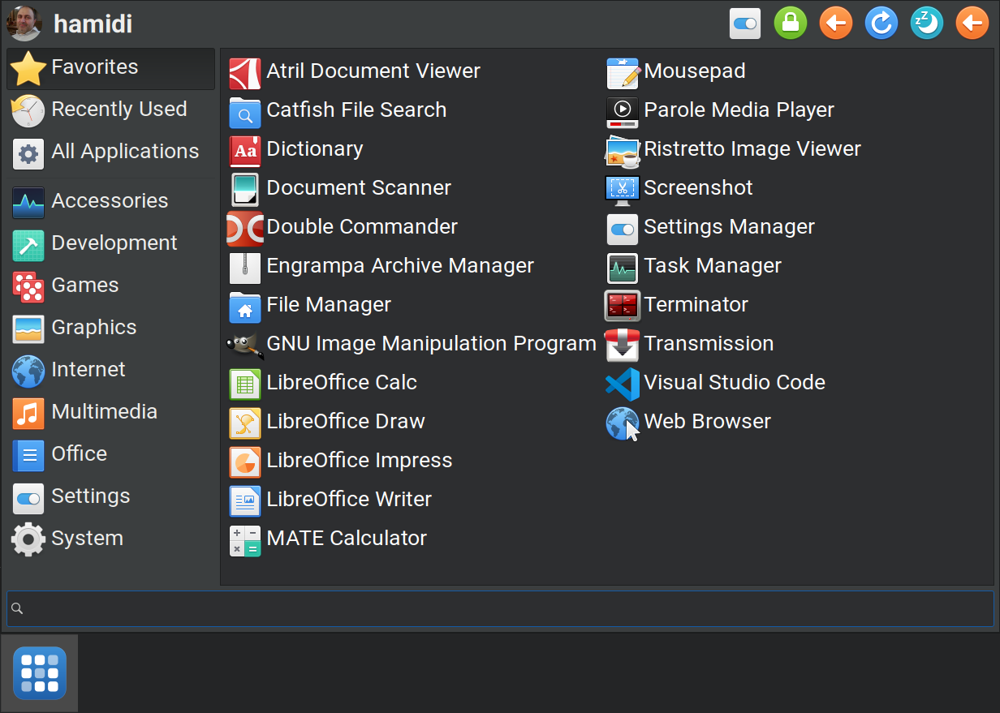

# Vibris Menu



Vibris Menu is an alternate application launcher for the Xfce panel. It
shows favorites, recently used applications and every category as a grid
of several columns, so a large menu fits on screen without scrolling.

Vibris Menu is a fork of Whisker Menu by Graeme Gott
(<https://gitlab.xfce.org/panel-plugins/xfce4-whiskermenu-plugin>). Most of
its code comes from Whisker Menu; thanks to Graeme Gott and to every
contributor and translator of that project. Vibris Menu uses its own names
(plugin, command, settings and icon), so both can be installed side by side.

## Features
- Multi-column grid on every page, columns filled top to bottom
- Configurable number of columns; the menu width follows the widest item
- Resize by dragging any edge of the menu; the size can be locked
- Searching for applications, bookmarks, and running commands
- Startup page setting, including "last used category"
- One spacing number for every gap of the menu, adjusted with the menu
  itself open as a live preview; icons shown without their own borders

## Keyboard shortcut
To open and close the menu from the keyboard, bind the command
`xfce4-popup-vibrismenu` to a key in the keyboard settings (Application
Shortcuts). Add `--pointer` to show the menu at the mouse pointer.

For the Super key there is a button in the settings (Behavior): "Open this
menu with Super and Ctrl+Esc". It is available while those keys belong to
something else (Xubuntu ships them bound to Whisker Menu) and takes effect
at once.

## Installation
**Ubuntu / Xubuntu (PPA):**

```sh
sudo add-apt-repository ppa:hamidi/vibris
sudo apt install xfce4-vibrismenu-plugin
```

**Debian package:** download the `.deb` from the [latest release](https://github.com/hamidi2/xfce4-vibrismenu-plugin/releases/latest) and install it:

```sh
sudo apt install ./xfce4-vibrismenu-plugin_*_amd64.deb
```

**From source:**

```sh
meson setup build
meson compile -C build
sudo meson install -C build
```

Then restart the panel (`xfce4-panel -r`) and add "Vibris Menu" to it
(right-click the panel > Panel > Add New Items).

## Reporting bugs
https://github.com/hamidi2/xfce4-vibrismenu-plugin/issues

## License
GNU General Public License, version 2 or later (see COPYING).
